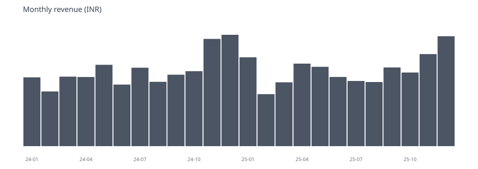

# Retail Sales Analysis — SQL + Python + Excel

End-to-end analytics demo: a synthetic retail dataset, 11 business questions
answered in SQL, a Python pipeline that runs them and exports results, a
16-sheet Excel / Google Sheets workbook, plus Power BI workflow notes.

> **About the data:** everything here is **synthetic sample data**, generated
> by a seeded PRNG (`scripts/generate_data.py`, seed 42). It is not real
> business data, and every number in this README comes from the committed
> sample run. Regenerating the data reproduces the same values.



## Why this project

It demonstrates the everyday skills of a data analyst on one coherent dataset:

- **SQL** — joins, CTEs, CASE pivots, window functions (`LAG`), date
  arithmetic, aggregation (`sql/02_analysis_queries.sql`)
- **Python** — CSV ingestion, SQLite, result exporting, zero-dependency SVG
  charting (`scripts/analyze.py`)
- **Data modelling** — a small star-like model (customers / products / orders)
  that also loads flat into Excel and Power BI
- **Business thinking** — each query answers a real stakeholder question

## Structure

```
retail-sales-analysis/
├── Retail-Sales-Analysis-Workbook.xlsx  # 16-sheet Excel / Google Sheets deliverable
├── data/          # customers.csv, products.csv, orders.csv (committed)
├── sql/
│   ├── 01_create_schema.sql      # SQLite DDL + indexes
│   └── 02_analysis_queries.sql   # 11 business questions (single source of truth)
├── scripts/
│   ├── generate_data.py          # seeded synthetic data generator
│   └── analyze.py                # runs every query, writes results/ + charts/
├── results/       # one CSV per business question (committed)
├── charts/        # monthly_revenue.svg (committed)
└── excel/         # Node builder: aggregates -> workbook, charts, verification
```

## Quick start

**Option A — run the full pipeline (Python 3.10+, standard library only):**

```bash
python scripts/generate_data.py   # writes data/*.csv
python scripts/analyze.py         # writes results/*.csv + charts/monthly_revenue.svg
```

**Option B — SQLite CLI only:**

```bash
sqlite3 retail.db < sql/01_create_schema.sql
sqlite3 retail.db -cmd ".mode csv" \
  -cmd ".import --skip 1 data/customers.csv customers" \
  -cmd ".import --skip 1 data/products.csv products" \
  -cmd ".import --skip 1 data/orders.csv orders" \
  < sql/02_analysis_queries.sql
```

**Option C — no setup:** open any file in `results/` — each one is a finished
answer.

**Option D — the workbook:** open `Retail-Sales-Analysis-Workbook.xlsx` (or import
it into Google Sheets). The Dashboard puts every headline percentage first, and
the `Orders` sheet keeps the full 2,701-line grain.

## Business questions

| # | Question | Result file |
|---|----------|-------------|
| Q1 | Headline KPIs (revenue, orders, customers, AOV) | `results/kpi_summary.csv` |
| Q2 | Monthly revenue trend | `results/monthly_revenue.csv` |
| Q3 | Year-over-year growth, 2025 vs 2024 | `results/yoy_growth.csv` |
| Q4 | Month-over-month momentum (window function) | `results/mom_growth.csv` |
| Q5 | Revenue and units by category | `results/category_revenue.csv` |
| Q6 | Top 10 products by revenue | `results/top_products.csv` |
| Q7 | Revenue and reach by region | `results/region_revenue.csv` |
| Q8 | Top 10 customers by revenue | `results/top_customers.csv` |
| Q9 | Repeat vs one-time customer mix | `results/repeat_vs_onetime.csv` |
| Q10 | Category × region revenue matrix | `results/category_region_matrix.csv` |
| Q11 | Best quarters by revenue | `results/best_quarters.csv` |

## Findings from the sample run

- **₹82.6 lakh revenue** across **1,687 orders** from **378 of 400 customers**
  (2 years, Jan 2024 – Dec 2025); average order value **₹4,897.49**.
- **Apparel leads by revenue (₹24.9 L)**, driven by Running Shoes
  (₹10.9 L, the #1 product); Electronics leads in units (1,750) but sits #2
  in revenue because of lower price points.
- **Clear festive seasonality:** Nov–Dec 2024 spiked to ₹4.8–5.0 L per month
  vs a ~₹3 L baseline; 2024-Q4 is the best quarter (₹13.2 L).
- **YoY growth is uneven** — strong Jan 2025 (+29.1%) but a soft Feb–Mar
  (−4.9%, −8.2%) — a realistic pattern the pipeline surfaces honestly.
- **Loyalty is the story:** 84.4% of ordering customers are repeat buyers,
  15.6% are one-time; the top customer (Diya Mehta, South) spent ₹1.03 L.
- **North and West regions** each contribute ~₹22 L, nearly identical reach
  (~97–99 customers) — marketing spend questions write themselves.

## Excel / Google Sheets workbook

[`Retail-Sales-Analysis-Workbook.xlsx`](Retail-Sales-Analysis-Workbook.xlsx) is the full
project in one workbook: **16 sheets, 8,991 live formulas, 6 dashboard charts and 12
in-cell data bars**, built from the same verified aggregates as `results/`.

**Percentages first.** The Dashboard opens with eight live KPI rates — repeat customer
share (84.4%), one-time share (15.6%), repeat revenue share (95.9%), Apparel share (30.2%),
Electronics share (26.8%), North + West share (53.2%), top-10 product share (78.4%) and
top-10 customer share (10.8%) — followed by volume KPIs, category/region splits, five
headline findings and six charts.

| Sheet group | Sheets |
|---|---|
| Dashboard | `Dashboard`, `KPI Summary` |
| Analysis | `Monthly Revenue`, `YoY Growth`, `MoM Growth`, `Category Revenue`, `Top Products`, `Region Revenue`, `Top Customers`, `Repeat vs One-time`, `Category x Region`, `Best Quarters` |
| Pivot sources | `Orders` (2,701 line items), `Customers` (400), `Products` (20) |
| Guide | `How To Use` — import steps, pivots, Power Query, definitions, limitations |

AOV, YoY, MoM, shares, cumulative shares, revenue per customer/unit, ranks, order revenue,
month and quarter are **formulas**, not typed values, so they recalculate when you edit a
cell. The workbook sets `fullCalcOnLoad`, so Excel and Google Sheets compute everything on
open.

### Import into Google Sheets

1. Open [sheets.google.com](https://sheets.google.com) and create a blank spreadsheet.
2. **File → Import → Upload** → choose `Retail-Sales-Analysis-Workbook.xlsx` → **Import data**.
3. Open the **Dashboard** tab. Percentages recalculate and the six charts appear as
   floating images. If an image is missing, insert it from `excel/assets/*.png`.

### Pivot recipes

The `Orders` sheet is the full line-item grain and already has a live `Revenue` column.

| Question | Rows / Columns | Values |
|---|---|---|
| Revenue by region × category | Rows: `Region`; Columns: `Category` | Sum of `Revenue` (or use `Category x Region`) |
| Monthly trend | Rows: `Month` | Sum of `Revenue`; distinct orders are on `Monthly Revenue` |
| Top products | Rows: `Product` | Sum of `Revenue`, Sum of `Quantity`; sort descending |
| Repeat mix | `Customers` → Rows: `Customer Type` | Count of `Customer ID`, Sum of `Revenue` |
| Quarter performance | Rows: `Quarter` | Sum of `Revenue`, Sum of `Quantity` |

### Power Query — full order-line grain

The workbook already includes all 2,701 order lines. To rebuild the model in Excel:
**Data → Get Data → From File → From Text/CSV**, load `data/orders.csv`,
`data/customers.csv` and `data/products.csv`, then merge orders to customers on
`customer_id` and to products on `product_id`. Apply the same definitions as
`sql/02_analysis_queries.sql`: revenue = `quantity × unit_price`; a repeat customer has
more than one distinct `order_id`.

### Rebuild and verify

```bash
cd excel
npm install
npm run all        # charts -> workbook -> 388 data checks + 272 workbook checks
```

`npm run charts` needs Microsoft Edge on Windows to rasterise the SVG charts; the chart
images are committed, so `npm run build` works without Edge.

**Honest notes**

- The six charts are embedded PNGs, not native Excel chart objects — ExcelJS has no chart
  API. Every number behind them is in the sheets, so they can be rebuilt.
- The dataset is synthetic (seed 42) and covers 24 months, so YoY uses a single prior year
  and seasonality claims are limited to this sample. It is not real business data.
- Verification is programmatic: `excel/verify-data.mjs` cross-checks 388 values against
  `results/*.csv`, and `excel/verify-workbook.mjs` reads the saved `.xlsx` back and checks
  272 things (sheet order, formulas, totals, charts, data bars, cross-sheet references).
  The file was not opened in the Excel desktop UI during the build because Office
  activation was unavailable and LibreOffice is not installed; Excel and Google Sheets
  recalculate on open via `fullCalcOnLoad`.

## Power BI workflow

No `.pbix` is committed (binary files don't review well) — the model takes
about 20 minutes to build:

1. **Get Data → Text/CSV** for the three files in `data/`.
2. **Model view:** relate `orders[customer_id]` → `customers[customer_id]` and
   `orders[product_id]` → `products[product_id]` (one-to-many, single direction).
3. **Measures:**
   ```dax
   Total Revenue = SUMX(orders, orders[quantity] * orders[unit_price])
   Total Orders  = DISTINCTCOUNT(orders[order_id])
   Avg Order Value = DIVIDE([Total Revenue], [Total Orders])
   ```
4. **Visuals:** line chart (`order_date` month × Total Revenue), clustered bar
   (region × category), matrix (category × region), top-N products slicer.

## Regenerating the data

```bash
python scripts/generate_data.py
```

The generator is deterministic (seed 42), so the committed CSVs, the results,
and this README stay in sync. `scripts/analyze.py` then rewrites
`results/` and `charts/` from whatever is in `data/`.
